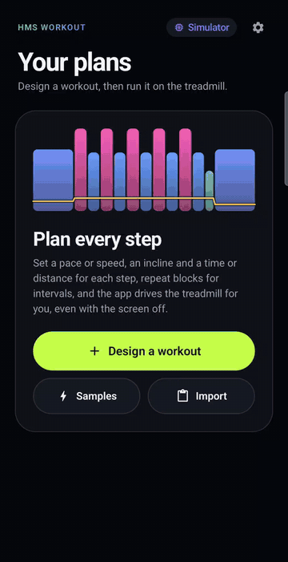
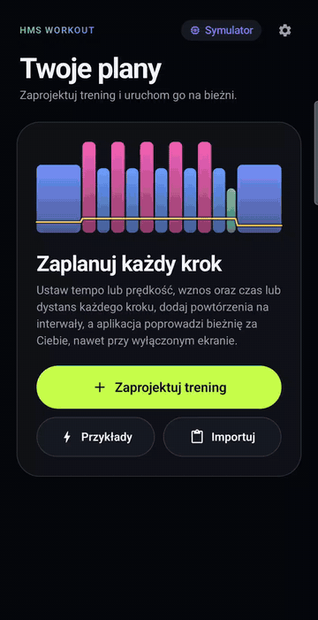

# treadmill

[](https://github.com/drymek/treadmill/actions/workflows/ci.yml)
[](https://pkg.go.dev/craftersy.com/treadmill/src/go/lib)
[](LICENSE)

Open-source control of **RZ_TreadMil** Bluetooth Low Energy treadmills: a reverse-engineered protocol
specification plus client libraries and apps in several languages.

The protocol was decoded on real hardware. Commands went out one by one, every notification was logged with
millisecond timestamps, and a USB camera photographed the treadmill display each second. Each documented byte
is backed by a log line and a photo, and the raw data is part of the repository.

## HMS workout

**[HMS workout](src/kotlin/workout)** is the Android app this project is built around: plan treadmill workouts
on your phone and let the app drive the treadmill while you run. Website and download:
**[drymek.github.io/treadmill](https://drymek.github.io/treadmill/)** (English and Polish).

- **Design every step.** A pace (`4:30/km`) or a speed, an incline, and a time or a distance; repeat blocks
  for intervals. A live profile shows the whole workout as you build it: bar width is time, height is speed,
  colour runs from walk to sprint, and the yellow line is the incline.
- **Run it hands-free.** The app starts the belt, sends each step's speed and incline, and moves on by time or
  by the treadmill's distance counter. It keeps going in the background and with the screen locked; the
  notification counts down and offers Skip and Stop, and each new step vibrates and beeps.
- **Plain files.** Workouts are [`.workout.yaml`](docs/workout.md) files you can write by hand, share from the
  app, import from the clipboard, a URL or a file, and check with [`task workout`](src/go/tools/workout).
- **Try it without a treadmill.** A built-in simulator runs any workout; nothing moves.
- English and Polish.

```bash
task workout:android   # or install from source on a phone connected with adb
```

The APK is part of every [release](https://github.com/drymek/treadmill/releases) as `hms-workout_<version>.apk`.

<p>
  
  
</p>

## Implementations

| Language | Path | Kind | Status |
|---|---|---|---|
| Go | [`src/go/lib`](src/go/lib) | library + simulator | ✅ start/stop, speed, incline, live status, heart rate, reconnect |
| Go | [`src/go/panel`](src/go/panel) | terminal app | ✅ virtual HMS console: display, buttons, simulator mode |
| Go | [`src/go/tools/probe`](src/go/tools/probe) | research tool | ✅ logs every notification, sends any command |
| Go | [`src/go/tools/workout`](src/go/tools/workout) | validator | ✅ checks `.workout.yaml` files, prints the plan |
| Kotlin | [`src/kotlin/lib`](src/kotlin/lib) | library + simulator (JVM) | ✅ start/stop, speed, incline, live status, heart rate, reconnect |
| Kotlin | [`src/kotlin/panel`](src/kotlin/panel) | Android app | ✅ virtual HMS console on the phone: display, buttons, simulator mode |
| Kotlin | [`src/kotlin/workout`](src/kotlin/workout) | Android app | ✅ plans `.workout.yaml` workouts and runs them, also with the screen locked |

New implementations go to `src/<language>/lib` for libraries and `src/<language>/<app>` for applications.

## Download

Every change merged into `main` that passes CI is published as a
[GitHub release](https://github.com/drymek/treadmill/releases) named `panel-v0.1.<build>`:

- `treadmill-panel_<version>_<os>_<arch>`: the terminal panel for macOS (`darwin`) and Linux, on `arm64` and
  `amd64`. The macOS binaries are not notarized; after downloading run
  `chmod +x <file> && xattr -d com.apple.quarantine <file>`.
- `hms-workout_<version>.apk`: [HMS workout](src/kotlin/workout), the Android workout app.
- `treadmill-panel_<version>.apk`: the Android panel.
- Both APKs are signed with the same key in every release, so each installs over its previous version.
- `SHA256SUMS`: checksums of all files.

## Protocol

[`docs/protocol.md`](docs/protocol.md) is the specification. In short: GATT service `FFF0`, commands written to
`FFF2` (`FB … FC`), status notified on `FFF1` (`FD … FE`), with a byte-sum checksum. The session log and photos
of the display are in [`docs/measurements`](docs/measurements).

[`docs/workout.md`](docs/workout.md) specifies the `.workout.yaml` file for planned workouts: steps with a pace
or speed, an incline and a length in time or distance. Check a file with:

```bash
task workout -- plan.workout.yaml
```

## Repository layout

```
docs/                 protocol specification, workout file format
docs/measurements/    raw session log and photos of the display
src/go/lib/           Go library: protocol, client, BLE transport, simulator, e2e tests
src/go/panel/         terminal app: a virtual HMS console (Bubble Tea)
src/go/tools/probe/   research tool: logs notifications, sends commands over stdin or HTTP
src/go/tools/workout/ workout file validator
src/kotlin/lib/       Kotlin library: protocol, client, reconnect, simulator (pure JVM)
src/kotlin/panel/     Android app: the virtual HMS console on a phone (Jetpack Compose, BLE)
src/kotlin/workout/   Android app: designs and runs workout plans (Jetpack Compose, BLE)
```

## Tasks

Every command the project needs is in [`Taskfile.yml`](Taskfile.yml) ([Task](https://taskfile.dev)):

```bash
task --list
task go:check        # format, vet, staticcheck, build, race tests (what CI runs)
task panel:sim       # the virtual console against the simulator, no hardware needed
task kotlin:check    # Kotlin unit tests, Android lint, debug APK
task panel:android   # install the Android console on a phone connected with adb
task workout:android # install HMS workout on a phone connected with adb
task go:e2e          # tests against a physical treadmill (belt stays still)
task probe           # log a session with the probe tool
task workout -- FILE # validate a workout file and print its plan
task cam:record      # photograph the console once per second (macOS)
```

## Contributing

Contributions are welcome, especially logs from other treadmill models. See [CONTRIBUTING.md](CONTRIBUTING.md),
the [Code of Conduct](CODE_OF_CONDUCT.md) and the [security policy](SECURITY.md).

## Safety

This software moves a treadmill belt. Always use the physical safety key, and never rely on a Bluetooth
connection to stop the belt. See the [Go library's safety notes](src/go/lib/README.md#safety).

## License

[MIT](LICENSE) © Marcin Dryka
