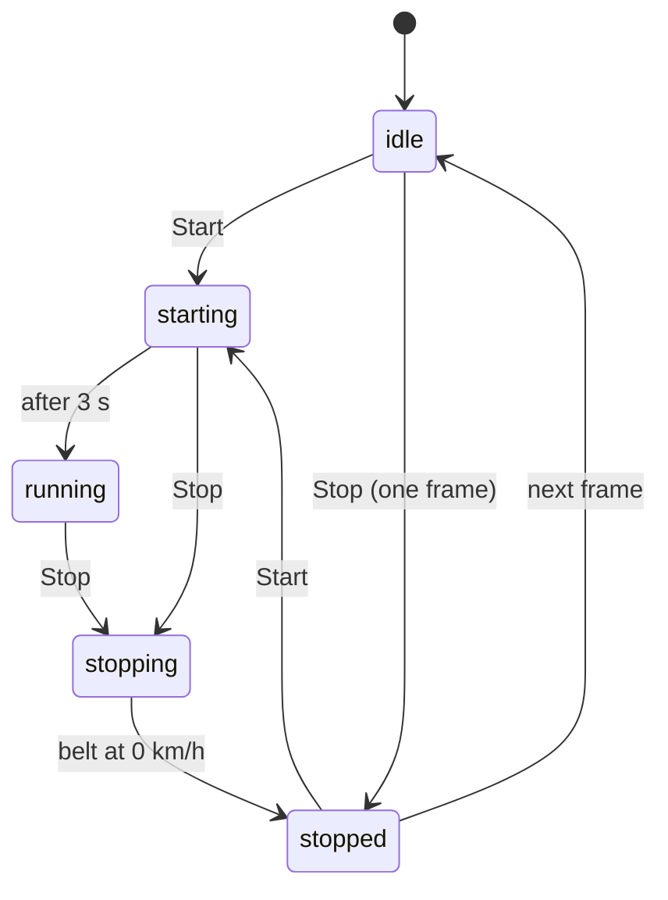

# RZ_TreadMil Bluetooth LE Protocol

| | |
|---|---|
| **Version** | 1.0 |
| **Date** | 2026-10-31 |
| **Status** | Reverse-engineered. Confirmed on one physical device. |
| **Device** | Treadmill advertising as `RZ_TreadMil` (HMS-branded console) |
| **Reference implementation** | [`src/go/lib`](../src/go/lib) |

This document specifies the Bluetooth Low Energy protocol used to control the treadmill and to read its live
status. The manufacturer does not publish it. Everything here was observed on real hardware: each command was
sent on its own, every notification was logged with millisecond timestamps, and a camera photographed the
console display once per second. [Appendix A](#appendix-a-measurement-log) lists the measurements behind each
statement; the raw log and a selection of photos are in [`measurements/`](measurements).

This project is not affiliated with the treadmill's manufacturer.

## Contents

1. [Conventions](#1-conventions)
2. [GATT profile](#2-gatt-profile)
3. [Frame format](#3-frame-format)
4. [Commands](#4-commands)
5. [Status notifications](#5-status-notifications)
6. [State machine](#6-state-machine)
7. [Implementation guidance](#7-implementation-guidance)
8. [Open questions](#8-open-questions)
9. [Methodology](#9-methodology)
- [Appendix A: Measurement log](#appendix-a-measurement-log)
- [Appendix B: Rejected hypotheses](#appendix-b-rejected-hypotheses)

## 1. Conventions

- Bytes are hexadecimal (`A1` = 0xA1 = 161). Frames are written byte by byte, e.g. `FB 03 A2 01 01 A7 FC`.
- Byte indices are zero-based from the first byte of the frame.
- Multi-byte integers are **big-endian**.
- *Speed* is in km/h. On the wire it is an unsigned byte in tenths of km/h (`1E` = 30 = 3.0 km/h).
- *Incline* is a unitless level, matching the number on the console display.
- *Confidence* marks each finding:

  | Mark | Meaning |
  |---|---|
  | ✅ Confirmed | Reproduced on the device and matched against the display |
  | ⚠️ Inferred | Consistent with every observation, but not tested directly |
  | ❓ Unknown | Observed without explanation |

## 2. GATT profile

| Item | Value | Notes |
|---|---|---|
| Advertised local name | `RZ_TreadMil` | ✅ |
| Service | `FFF0` (`0000fff0-0000-1000-8000-00805f9b34fb`) | the only service involved ✅ |
| Characteristic `FFF1` | notify | status frames, treadmill → client ✅ |
| Characteristic `FFF2` | write | command frames, client → treadmill; write-with-response succeeds ✅ |

The treadmill accepts one connection at a time and stops advertising while a client is connected. ✅

## 3. Frame format

Both directions use the same structure. The direction is identified by the start and end bytes.

```
Command (client → treadmill)     FB  LEN  GROUP  TYPE  MASTER  DATA…   CHK  FC
Status  (treadmill → client)     FD  LEN  CODE   PAYLOAD…              CHK  FE
```

| Field | Command | Status |
|---|---|---|
| Start byte | `FB` | `FD` |
| `LEN` | number of bytes from `GROUP` to the last `DATA` byte, i.e. `3 + len(DATA)` | frame length − 2 (every byte except `FD` and `FE`) |
| `CHK` | low byte of the sum of all bytes from `LEN` to the byte before `CHK` | same rule |
| End byte | `FC` | `FE` |

The `LEN` rules differ between directions. For a command, `frame length = LEN + 4`; for a status frame,
`frame length = LEN + 2`. ✅

Checksum examples:

```
FB 03 A2 01 01 A7 FC                        03 + A2 + 01 + 01               = A7
FD 05 A1 00 00 A6 FE                        05 + A1 + 00 + 00               = A6
FD 10 A1 00 14 00 01 01 00 1E 00 … 00 E5 FE  10 + A1 + 14 + 01 + 01 + 1E    = E5
```

The checksum held for all 3,280 notifications captured across the sessions. ✅

## 4. Commands

### 4.1 Summary

| Command | GROUP | TYPE | DATA | Example frame | Confidence |
|---|---|---|---|---|---|
| Start | `A2` | `01` | — | `FB 03 A2 01 01 A7 FC` | ✅ |
| Stop | `A2` | `04` | — | `FB 03 A2 04 01 AA FC` | ✅ |
| Set speed and incline | `A1` | `02` | `SPEED INCLINE 00 00` | `FB 07 A1 02 01 1E 02 00 00 CB FC` (3.0 km/h, incline 2) | ✅ |

`MASTER` must be `01`. With `00`, the treadmill ignores *Stop* and *Set speed and incline*. *Start* works with
either value. ✅

### 4.2 Start

`FB 03 A2 01 01 A7 FC`

- The treadmill answers within ~80 ms with the compact frame `FD 05 A1 01 03 AA FE` (state *starting*). ✅
- A 3-second countdown follows (the console shows 3, 2, 1). Full frames report state *starting* with target
  speed 1.0 km/h. ✅
- The belt then runs at **1.0 km/h** and the state becomes *running*. ✅
- Elapsed time, distance and calories restart from zero. ✅

### 4.3 Stop

`FB 03 A2 04 01 AA FC`

- **While moving:** the state becomes *stopping* and the belt slows by about 0.3 km/h every 0.65 s. Status
  frames arrive every ~0.65 s during braking. The incline returns to 0. When the belt halts, one frame with
  state *stopped* carries the final elapsed time, distance and calories, then the compact *idle* frame
  resumes. ✅
- **While idle:** a single full frame with state *stopped* and all fields zero, then *idle* again. ✅
- In the first *stopping* frame the target speed is `00`. In later frames it equals the current speed. ✅

### 4.4 Set speed and incline

`FB 07 A1 02 01 <SPEED> <INCLINE> 00 00 <CHK> FC`

| DATA byte | Meaning | Accepted range |
|---|---|---|
| 0 | target speed, 0.1 km/h | `0A`–`DC` (1.0–22.0 km/h), step 0.1 km/h ✅ |
| 1 | target incline | `00`–`16` (0–22) ✅ |
| 2–3 | reserved; send `00 00` | other values had no visible effect ✅ |

- **Both values always apply.** There is no way to change only one of them. To change the speed, send the
  current incline, and vice versa. Sending incline `00` while changing the speed levels the deck. ✅
- **Out-of-range values are ignored, not clamped.** The previous target stays and no error is signalled. The
  treadmill still sends its usual reply frame, so a reply does not mean the command was accepted. ✅
- Accepted values are visible in the reply frame ~100 ms later (target speed and incline bytes). ✅
- The command was only tested while the belt was running. ⚠️

### 4.5 Ignored commands

No visible effect, while idle or running ✅:

| GROUP | TYPE values tried | Reply frame |
|---|---|---|
| `A2` | `00`, `02`, `03`, `05`, `06` | none |
| `A1` | `00`, `01`, `03`, `04`, `05` (with 4 DATA bytes) | yes, see [7.4](#74-transient-values-after-unusual-commands) |

There is no pause command.

## 5. Status notifications

### 5.1 Timing

| Situation | Interval |
|---|---|
| Any state except braking | 1.29 s (observed 1.26–1.32 s), also when nothing changes ✅ |
| Braking (*stopping*) | ~0.65 s ✅ |
| After a command | one extra frame ~100 ms after an accepted `A1` command or a *Start*/*Stop* ✅ |

Only `CODE = A1` has been observed. ✅

### 5.2 Compact frame (7 bytes)

`FD 05 A1 <STATE> <AUX> <CHK> FE`

| Example | Meaning |
|---|---|
| `FD 05 A1 00 00 A6 FE` | idle; the console scrolls "WELCOME" ✅ |
| `FD 05 A1 01 03 AA FE` | start acknowledged; `AUX = 03` is probably the countdown length ⚠️ |

### 5.3 Full frame (18 bytes)

`FD 10 A1 …` with `LEN = 10` (16).

| Byte | Field | Encoding | Confidence |
|---|---|---|---|
| 0 | start | `FD` | ✅ |
| 1 | length | `10` | ✅ |
| 2 | code | `A1` | ✅ |
| 3 | state | see [5.4](#54-states) | ✅ |
| 4 | target speed | 0.1 km/h; changes as soon as a command is accepted | ✅ |
| 5 | current speed | 0.1 km/h; follows the target at about 0.5 km/h per second | ✅ |
| 6 | incline | target level; set immediately, not the motor position | ✅ |
| 7 | incline (copy) | always equal to byte 6 | ✅ |
| 8 | unknown | always `00`; possibly hours | ❓ |
| 9 | elapsed minutes | 0–59 observed | ✅ |
| 10 | elapsed seconds | 0–59 | ✅ |
| 11–12 | distance | uint16 BE, units of 10 m (`00 05` = 0.05 km) | ✅ |
| 13–14 | calories | uint16 BE, units of 0.1 kcal (`00 23` = 3.5 kcal) | ✅ |
| 15 | heart rate | bpm from the hand grip sensors; `00` without contact | ✅ |
| 16 | checksum | see [3](#3-frame-format) | ✅ |
| 17 | end | `FE` | ✅ |

Annotated example (3.0 km/h, incline 2, 1:00 elapsed, 30 m, 2.3 kcal):

```
FD 10 A1 02 1E 1E 02 02 00 01 00 00 03 00 17 00 0E FE
         │  │  │  │  │  │  │  │  └─┬─┘ └─┬─┘ │
         │  │  │  │  │  │  │  │    │     │   └ heart rate: none
         │  │  │  │  │  │  │  │    │     └ calories: 0x0017 = 23 → 2.3 kcal
         │  │  │  │  │  │  │  │    └ distance: 0x0003 = 3 → 30 m
         │  │  │  │  │  │  │  └ seconds: 0
         │  │  │  │  │  │  └ minutes: 1
         │  │  │  │  │  └ unknown
         │  │  │  │  └ incline (copy)
         │  │  │  └ incline: 2
         │  │  └ current speed: 3.0 km/h
         │  └ target speed: 3.0 km/h
         └ state: running
```

### 5.4 States

| Value | State | Frame | Description |
|---|---|---|---|
| `00` | idle | compact, or full while the console is being set up | belt stopped ✅ |
| `01` | starting | compact once, then full | countdown after *Start* ✅ |
| `02` | running | full | belt moving ✅ |
| `04` | stopping | full | braking after *Stop* ✅ |
| `05` | stopped | full, once | final metrics after braking, or the reply to *Stop* while idle ✅ |

### 5.5 Console set-up mode

When a program (PROG) or a target (MODE) is chosen on the console while the belt is stopped, the treadmill
sends full frames with state `00` and the fields carry **targets instead of counters** ✅:

| Selection | Bytes that change |
|---|---|
| Program P01 / P02 | byte 4 = program speed (`14` = 2.0 km/h), bytes 6–7 = program number, byte 9 = `1E` (30-minute duration) |
| Time target | byte 9 = minutes (`1E` = 30:00) |
| Distance target | bytes 11–12 (`00 64` = 1.00 km) |
| Calorie target | bytes 13–14 (`01 F4` = 50.0 kcal) |

The compact idle frame resumes when the selection is cleared.

## 6. State machine



The console's own START and STOP buttons produce the same transitions and frames as the BLE commands. ✅

## 7. Implementation guidance

### 7.1 Confirm every command

Because invalid values are ignored silently (4.4) and every accepted command produces a reply, a client
should treat a command as successful only when a status frame reflects it:

| Command | Confirmed by |
|---|---|
| Start | state *starting* or *running* |
| Stop | state *stopping*, *stopped* or *idle* |
| Set speed and incline | full frame with target speed and incline equal to the values sent |

### 7.2 Read-modify-write for speed and incline

Keep the latest status and fill in the value that should not change from it. Serialise commands, so that two
concurrent changes cannot overwrite each other.

### 7.3 Validate before sending

Reject speeds outside 1.0–22.0 km/h and inclines outside 0–22 in the client. The treadmill would ignore them
without an error.

The treadmill accepts targets up to 22.0 km/h, but the belt was not driven above 3.5 km/h during the
measurements. The maximum speed the motor reaches is unverified.

### 7.4 Transient values after unusual commands

After commands outside the documented set (unknown `TYPE` values, non-zero reserved bytes), the *first* reply
frame sometimes contained wrong values, even though its checksum was valid:

| Command sent | First reply | Next frame |
|---|---|---|
| `A1 02` with DATA `0F 00 01 00` | target speed `A9` (16.9 km/h) | `0F` (1.5 km/h); current speed stayed at 1.0 |
| `A1 01` | incline `E8` | `00` |
| `A1 04` | state `04` (stopping) | `02` (running); the belt did not brake |

This never happened after the documented commands. Clients should send only those commands, and should not
act on a single surprising frame.

### 7.5 Changes from the console

Speed, incline, start and stop changes made on the console are reported like BLE changes. Speed and incline
buttons have no effect while the belt is stopped. Clients must expect the state to change without their
commands.

### 7.6 Connection loss

The treadmill keeps its last setting when the connection drops: the belt keeps running. Applications must not
rely on Bluetooth to stop the belt. The physical safety key remains the only reliable stop. A client should
report the disconnection to the user and may reconnect. After a client disconnects, the treadmill advertises
again within seconds and accepts a new connection; consecutive end-to-end test runs rely on this. ✅

## 8. Open questions

| # | Question | What would answer it |
|---|---|---|
| 1 | Byte 8 has always been `00`. Is it hours, or does byte 9 count past 59 minutes? | A run longer than 60 minutes |
| 2 | Is `AUX = 03` in the start acknowledgement the countdown length? | A device or firmware with a different countdown |
| 3 | Selecting program P03 on the console produced no frame at all, unlike P01 and P02. | Repeat with all programs |
| 4 | What speed does the belt actually reach near 22.0 km/h? | A supervised high-speed run |
| 5 | Does *Set speed and incline* work during the countdown or while idle? | Send it in those states |
| 6 | What happens when the safety key is pulled? | Pull the key while running |
| 7 | Are reserved DATA bytes 2–3 of *Set speed and incline* used by other models? | Logs from other devices |

## 9. Methodology

1. **Logging.** The probe tool ([`src/go/tools/probe`](../src/go/tools/probe)) connects to the treadmill, subscribes to `FFF1` and writes
   every notification to a log with millisecond timestamps. It also accepts commands over HTTP, so each
   command is logged next to the frames that follow it.
2. **Display capture.** A USB camera photographs the console once per second into files named `HHMMSS.jpg`.
   The console cycles between screens (speed, incline, distance, time, calories, pulse) every few seconds,
   so each command was compared against 10–15 photos.
3. **Isolation.** Commands were sent one at a time, with several status intervals between them. Speed limits
   were probed by setting a value and restoring 1.0 km/h 0.3 s later, so the belt never actually accelerated.
4. **Safety.** Every test that moved the belt ran with the safety key attached.

## Appendix A: Measurement log

All sessions took place on 2026-10-31 on the same device, in one continuous log:
[`measurements/2026-10-31.log`](measurements/2026-10-31.log). Times are local (`HH:MM:SS.mmm`). Frames are shown in full, or as bytes 3–15 of a full frame where noted.

### Session 0: belt stopped

**Idle traffic, 08:37:45–08:38:58.** 61 notifications, all `FD 05 A1 00 00 A6 FE`, interval 1.26–1.32 s
(median 1.29 s).

**Stop, master, 08:38:58.839.** `FB 03 A2 04 01 AA FC` → 100 ms later
`FD 10 A1 05 00 00 00 00 00 00 00 00 00 00 00 00 B6 FE`, then compact idle frames.

**Stop, `MASTER = 00`, 08:39:08.593.** `FB 03 A2 04 00 A9 FC` → no reply.

**Console buttons, belt stopped, 08:46:20–08:46:56** (bytes 3–15):

| Time | Frame | Display |
|---|---|---|
| 08:46:27 | `00 14 00 01 01 00 1E 00 00 00 00 00 00` | P01, 30:00 |
| 08:46:36 | `00 14 00 02 02 00 1E 00 00 00 00 00 00` | P02, 2.0, 30:00 |
| — | no frame | P03 (photo 08:46:38) |
| 08:46:42 | compact idle | 0.00 / 0.0 / 0:00 |
| 08:46:45 | `00 00 00 00 00 00 1E 00 00 00 00 00 00` | 30:00, scrolls "TIME" |
| 08:46:49 | `00 00 00 00 00 00 00 00 00 64 00 00 00` | DIST 1.00 |
| 08:46:53 | `00 00 00 00 00 00 00 00 00 00 01 F4 00` | 50.00, scrolls "CAL" |
| 08:46:56 | compact idle | "WELCOME" |

Speed and incline buttons pressed with the belt stopped: no change on the display and 170 consecutive idle
frames from 08:47:10.

### Session 1: start, speed, incline, stop

Bytes 3–15 of full frames unless noted.

| Time | Event | Frames | Display |
|---|---|---|---|
| 08:51:48.062 | `start` | | |
| 08:51:48.140 | | compact `FD 05 A1 01 03 AA FE` | |
| 08:51:48.201 | countdown, 3 frames | `01 0A 05 00 00 00 00 00 00 00 00 00 00` | countdown, 1.0 |
| 08:51:51.202 | running | `02 0A 05 …`, then `02 0A 0A …`; byte 10 counts seconds | 0:03 |
| 08:52:12.483 | `set 2.0 0` | +110 ms: `02 14 0A …`; byte 5: `0D`, `13`, `14` | 2.0 |
| 08:52:30.942 | `set 3.0 2` | +105 ms: `02 1E 14 02 02 …`; byte 5: `15`, `1C`, `1E` | 3.0, INCL 2 |
| 08:52:52.138 | | bytes 9–10 roll over from `00 3B` to `01 00` | |
| 08:53:01.656 | `set 3.5 0` | +110 ms: `02 23 1E 00 00 …`, incline reset | 3.5, INCL 0 |
| 08:53:11 | | calories `00 23`, distance `00 05` | 3.50 kcal, 0.05 km |
| 08:53:36.430 | `stop` | +110 ms: `04 00 23 …`; then bytes 4 and 5 equal, falling by ~3 every 0.65 s | |
| 08:53:43.528 | stopped | `05 00 00 00 00 00 01 2D 00 07 00 35 00` (1:45, 70 m, 5.3 kcal) | |
| 08:53:44.758 | | compact idle | |

### Session 2: limits

- **Unknown `A2` types** `00`, `02`, `03`, `05`, `06` with `MASTER = 01`, idle (09:12:25–09:12:48) and running at
  1.0 km/h (09:15:44–09:16:14): no reply, no change.
- **0.1 km/h step:** `set 1.1 0` at 09:13:09 → byte 4 `0B`, byte 5 `0A → 0B`.
- **Minimum speed:** 0.5, 0.1 and 0.9 km/h were ignored (target stayed `0B`, a reply frame was still sent); 1.0
  km/h was accepted.
- **Maximum speed** (each value followed by `set 1.0 0` 0.3 s later; current speed never exceeded 1.1 km/h):
  12.0, 12.1, 14.0, 16.0, 20.0 and 22.0 accepted; 22.1, 23.0, 24.0 and 25.0 ignored.
- **Maximum incline** (same method, at 1.0 km/h): 12, 13, 15, 16 and 22 accepted; 23 and 30 ignored.
- **Incline position:** `set 1.0 5` at 09:15:15 → bytes 6 and 7 both `05` immediately and unchanged for 15 s while
  the motor moved; display INCL 5.
- **Counters:** `stop` at 09:16:27 → stopped frame with 3:20, 60 m, 4.7 kcal; display reset to 0:00 at once.
  `start` at 09:16:35 → counters from zero.

### Session 3: master byte, reserved bytes, console while running

- **`start` with `MASTER = 00`** (09:20:22): normal countdown and run.
- **`set 1.5 0` with `MASTER = 00`** (09:20:36): reply frame, target unchanged.
- **`stop` with `MASTER = 00`** while running (09:20:40): no effect.
- **Reserved bytes** `01 00`, `00 01`, `05 05`, `FF FF` in `A1 02` (09:20:54–09:21:07): speed set to 1.5 km/h
  as requested, no other effect. First reply to `01 00` showed target `A9`, corrected 60 ms later.
- **Unknown `A1` types** `01`, `03`, `04`, `05`, `00` with DATA `0F 00 00 00` (09:21:38–09:21:55): no effect;
  transient values in the first reply to `01` and `04` (see [7.4](#74-transient-values-after-unusual-commands)).
- **Console while running** (09:23:39–09:26:07):
  - START: same frames as the BLE command;
  - `+` / `−`: target speed ±0.1 km/h per press (`0A → 0F → 0A`);
  - `△` / `▽`: incline ±1 (`00 → 03 → 00`);
  - quick keys: "3" → speed `1E`, "3%" → incline `03`;
  - hand grip sensors: byte 15 rose from `4B` to `5E`; display PUL 76, 84, 94 matched `4C`, `54`, `5E`;
  - STOP: same as the BLE command; the incline returned to 0 while braking (`03 → 02 → 00`).

## Appendix B: Rejected hypotheses

An earlier prototype tried the frames below. None of them had any effect, and none follows the framing
in [section 3](#3-frame-format):

| Frame | Idea behind it |
|---|---|
| `FD 05 A0 <speed> <chk> FE` | command in status framing |
| `FD 10 A0 …` (18 bytes) | status frame echoed back with `CODE = A0` |
| `FD 08 A0 00 F0 01 00 01 9A FE`, `FD 07 A0 01 0F 07 01 BF FE`, `FD 08 A0 03 01 A9 FC 00 51 FE` | "init" sequences of unknown origin |

Earlier assumptions in the prototype, all disproved by the measurements above:

- time, distance and calories as little-endian values at bytes 10–15;
- incline left untouched when only the speed is sent;
- a status frame always 18 bytes long;
- `MASTER = 00` handing control back to the console.
