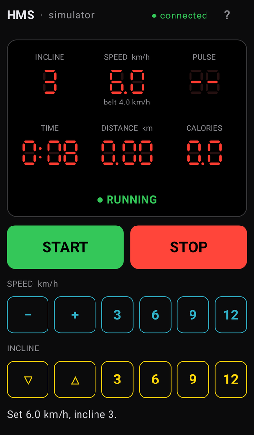
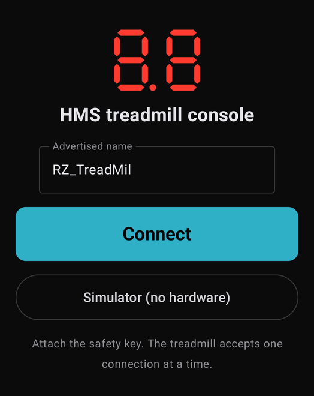

# Android panel

The virtual HMS console on an Android phone, with the same features as the [terminal panel](../../go/panel): all
six readouts of the treadmill display at once as red seven-segment digits, and the console buttons.

<p>
  
  
</p>

| Button | Console button | Effect |
|---|---|---|
| START | START | 3-second countdown, then 1.0 km/h |
| STOP | STOP | brake to a halt |
| − / + | − / + | speed −0.1 / +0.1 km/h |
| 3 6 9 12 (speed row) | quick keys | speed 3, 6, 9, 12 km/h |
| ▽ / △ | ▽ / △ | incline −1 / +1 |
| 3 6 9 12 (incline row) | quick keys | incline 3, 6, 9, 12 |
| ? | | help |
| back | | leave the console; a moving belt is stopped first (press back twice to leave at once) |

A hardware keyboard works with the terminal panel's keys: `enter`, `space`/`x`, `p`/`m`/`+`/`-`/`←`/`→`,
`3 6 9 0`, `↑`/`↓`/`k`/`j`, `a s d f`, `?`, `q`/`esc`.

## Run

```bash
task kotlin:setup    # once: JDK 21 and the Android SDK via Homebrew
task kotlin:build    # debug APK in src/kotlin/panel/build/outputs/apk/debug/
task panel:android   # install on the phone connected with adb, and open it
```

To install on a phone, enable *Developer options → USB debugging* (or *Wireless debugging*), connect it and check
that `adb devices` lists it. The app needs Android 12 or later and the *Nearby devices* permission.

The first screen offers **Connect** (Bluetooth, by advertised name) and **Simulator**, which runs the console
against the built-in simulator without hardware.

## How it behaves

- **Every command is confirmed** by the treadmill before the panel reports it. Values the treadmill would
  ignore (below 1.0 km/h, incline below 0 or above 22) are refused with a message instead of being sent.
- **Commands keep their order.** Pressing + five times quickly gives exactly +0.5 km/h, and STOP is never
  overtaken by an earlier command.
- **Changes on the real console** show up on the phone within about a second.
- **Connection loss** shows a red banner. The belt keeps its last setting while the app reconnects, so use the
  console STOP or the safety key.
- **Leaving** stops a moving belt. When the app is closed in another way (from the recent apps list, for
  example), it still tries to stop the belt, but Android may end the process first.
- **The screen stays on** while the console is shown. The app does not run in the background.

Always attach the safety key. A phone is not an emergency stop.
