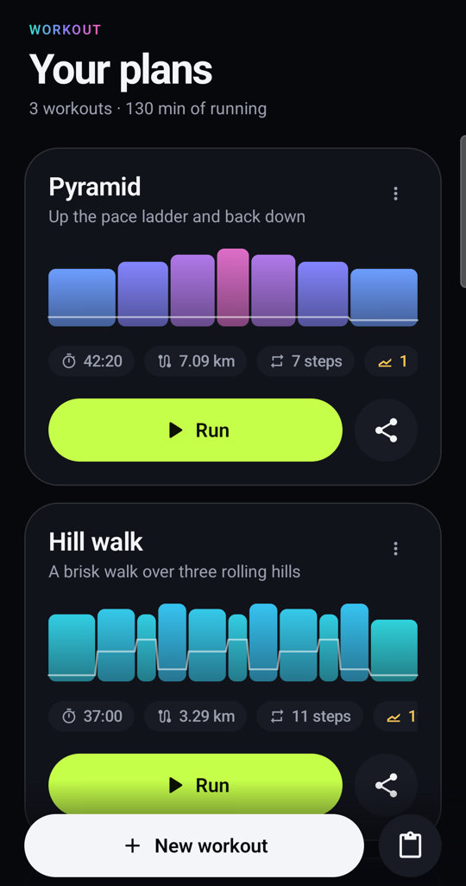
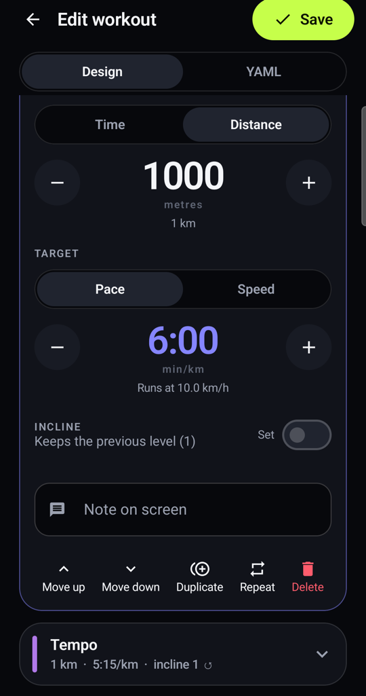
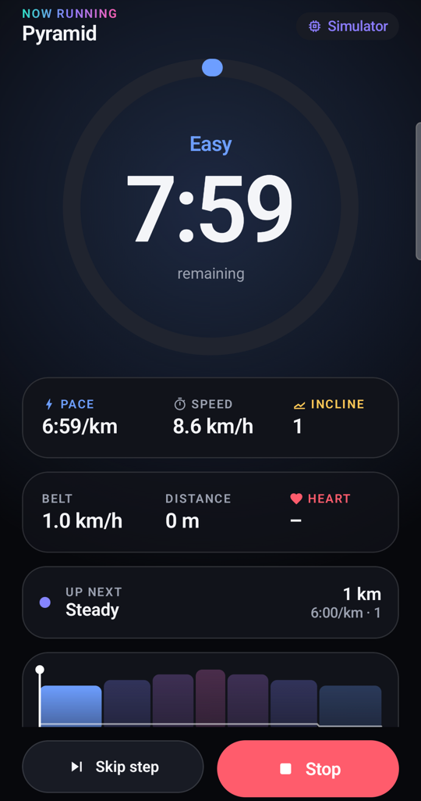

# HMS workout

The Android app that plans treadmill workouts as [`.workout.yaml`](../../../docs/workout.md) files and runs them
on the treadmill: a library of workouts, an editor for every option of the format, and a run screen that sends
each step's speed and incline and moves on by time or by distance.

<p>
  
  
</p>

<p>
  
  
  
</p>

## Features

- **Library.** Every workout with a profile chart (bar width is the step's time, height its speed, colour from
  walk to sprint, the line is the incline), estimated time and distance, Run and Share. The menu edits,
  duplicates, shows or copies the YAML and deletes.
- **Import.** From the clipboard, from an http(s) URL, from a file, or shared from another app. Every problem in
  the file is listed with its line and step, like the [Go validator](../../go/tools/workout).
- **Share.** The Android share sheet, as a `.workout.yaml` file and as text.
- **Open with.** `.workout.yaml` files open in the app from file managers. Android has no type for `.yaml`, and
  Samsung My Files sends such files with an empty type and no file name, so the app also accepts untyped files from
  the phone's storage and checks the name and content itself. The price: it is offered for other files opened from
  My Files too, e.g. PDFs, and refuses them.
- **Editor.** Name, description, steps and repeat blocks; per step a time or a distance, a pace or a speed (with
  the speed and actual pace the treadmill will run), an incline or "keep the previous one", and a note. Steps and
  blocks move, duplicate and delete; a step can be wrapped in a repeat block and a block unwrapped. The YAML tab
  shows the file that will be saved.
- **Run.** A foreground service runs the workout, so it keeps controlling the treadmill in the background and with
  the screen locked. The notification counts the step down and offers Skip and Stop; step changes vibrate and
  beep. The run screen shows the step's countdown ring, pace, speed, incline, note, the next step and live
  readings from the treadmill.
- **Settings.** The gear in the library holds what rarely changes: the language, the treadmill's Bluetooth name
  and the simulator. With the simulator on, Run becomes Simulate and nothing moves.
- **Languages.** English and Polish (`res/values-pl`, including the sample workouts in `res/raw-pl`), following
  the phone or chosen in the settings. Import errors stay in English, like the file's keys and the Go validator.

## Safety

Run starts the belt after the treadmill's 3-second countdown, so attach the safety key first. Stop asks once more
and brakes the belt.
If the belt stops on the console, the workout ends. If the connection drops, the workout ends and the app stops
the belt as soon as it reconnects; until then the belt keeps its last speed, so stop it on the console or pull the
safety key.

## Run

```bash
task kotlin:setup      # once: JDK 21 and the Android SDK via Homebrew
task workout:android   # install on the phone connected with adb, and open it
task kotlin:check      # unit tests, lint and debug APKs of both apps
```

## Code

| Package | What |
|---|---|
| `format` | the file format: model, `WorkoutParser` (every problem with its line), `WorkoutWriter`, pace and speed conversion |
| `run` | `WorkoutRunner` (Android-free, tested against the simulator) and `WorkoutService` (foreground service, notification) |
| `data` | the library: one file per workout in the app's storage, URL download, samples |
| `bluetooth` | BLE transport, a copy of the [Android panel's](../panel); keep both in step |
| `ui` | Compose screens and the design system |
